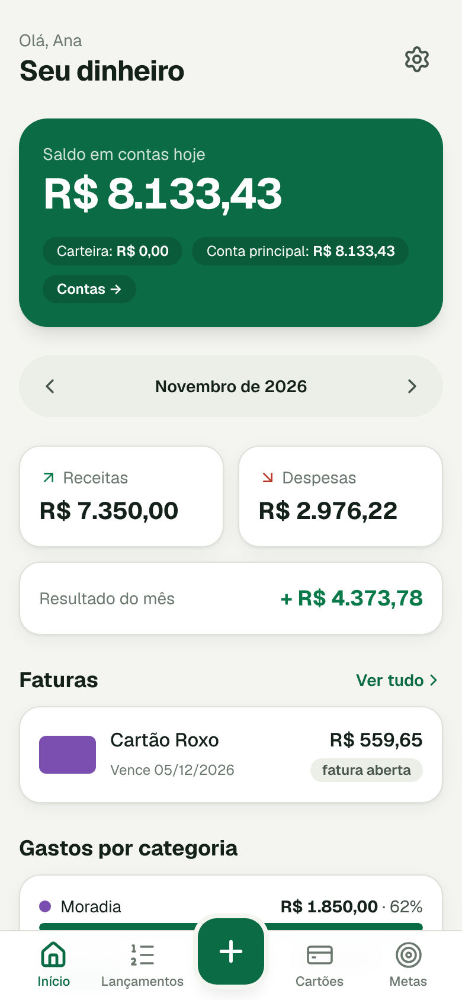
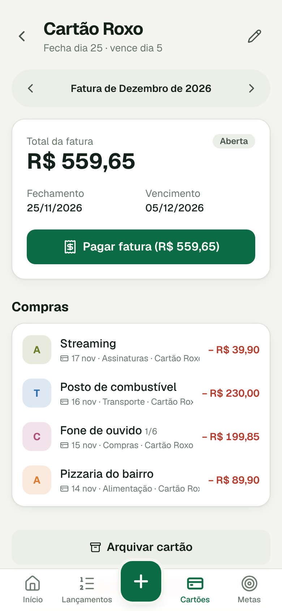
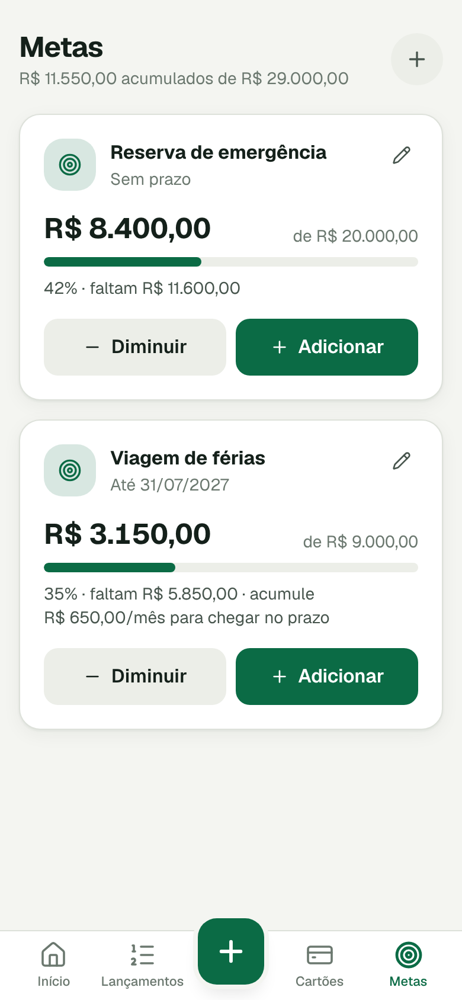
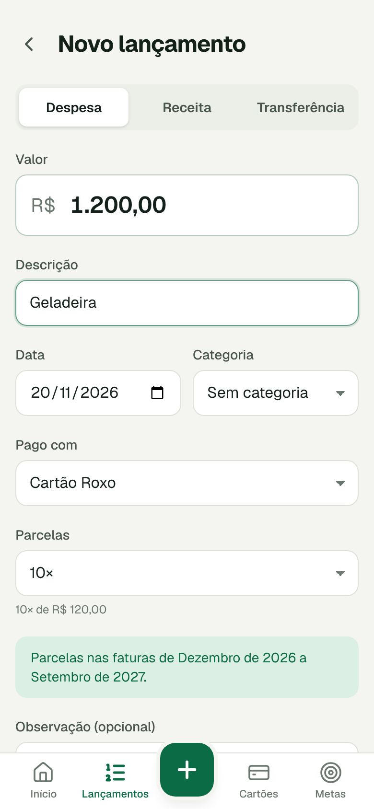
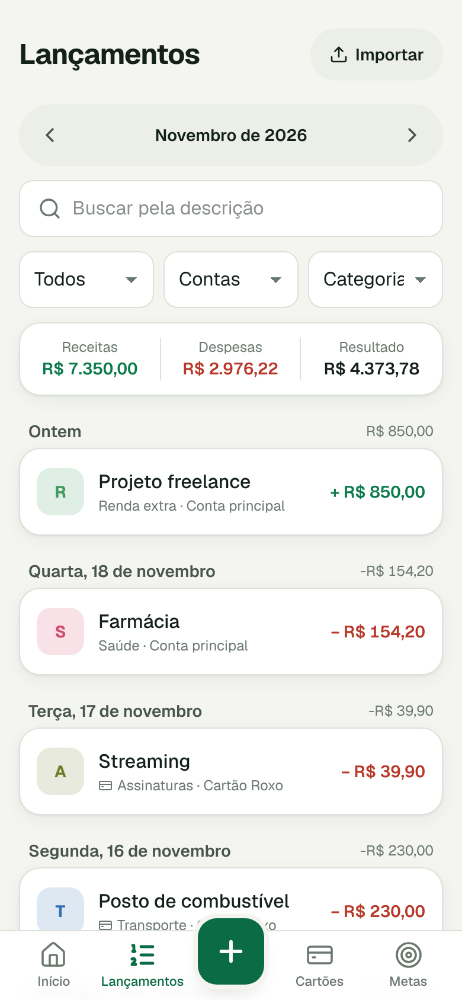
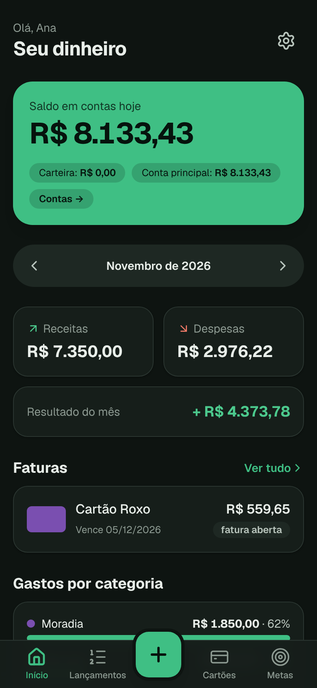

<p align="center">
  
</p>

<h1 align="center">Granaa</h1>

<p align="center">
  Controle financeiro pessoal, simples e feito para o celular.<br>
  Acompanhe cada centavo que entra e sai, organize os gastos do dia a dia, controle cartões de crédito e acompanhe suas metas de economia.
</p>

<p align="center">
  
  
  
</p>

O Granaa é um aplicativo web que pode ser instalado na tela inicial do celular, no iPhone ou no Android, e funciona como um app comum. Ele roda nos planos gratuitos do [Supabase](https://supabase.com) e da [Vercel](https://vercel.com). Este README explica como ele funciona e como publicá-lo. Os termos de uso do código estão em [Licença](#licença).

## Funcionalidades

**Lançamentos.** Registre despesas, receitas e transferências entre contas em poucos toques, com categoria, data e observação. A lista mostra os lançamentos agrupados por dia, com busca e filtros por tipo, conta, cartão e categoria.

**Contas.** Cadastre conta corrente, poupança, carteira e investimentos. O saldo de cada conta é calculado a partir do saldo inicial e dos lançamentos.

**Cartões de crédito.** Informe os dias de fechamento e de vencimento, e o Granaa coloca cada compra na fatura certa. Compras parceladas, em até 24 vezes, são distribuídas automaticamente pelas faturas seguintes. A fatura mostra a situação (aberta, fechada, vencida ou paga), permite registrar o pagamento e acompanha o limite disponível.

**Metas.** Defina um valor-alvo e, se quiser, um prazo. O app mostra o progresso e quanto acumular por mês para chegar lá. A meta é um parâmetro de acompanhamento: você informa o valor acumulado, que pode estar distribuído em várias contas e investimentos.

**Importação de extratos.** Importe arquivos OFX, CSV ou Excel 97-2003 (.xls) exportados pelo banco. Antes de salvar, o app mostra uma prévia em que você confere cada linha. Ele também:

- sugere a categoria com base no seu histórico, em palavras-chave e na categoria informada pelo próprio banco;
- reconhece linhas já importadas e não as duplica;
- identifica transferências entre as suas próprias contas (Pix para o seu nome, aplicações e resgates) e permite registrá-las como transferência, em vez de receita ou despesa;
- pareia estornos e cancelamentos com a compra original e deixa os dois de fora;
- deixa de fora, por padrão, os pagamentos de fatura, para o gasto do cartão não ser contado duas vezes.

O arquivo é lido no próprio aparelho. Só os lançamentos que você confirmar são enviados ao banco de dados.

**Painel inicial.** Saldo total, receitas e despesas do mês, faturas abertas, gastos por categoria, metas e últimos lançamentos. Ao tocar numa categoria, o painel lista os lançamentos que formam aquele total, do maior para o menor, e leva à tela de lançamentos já filtrada pela categoria e pelo mês.

**Exportação para planilha.** Na tela de lançamentos, o botão **Exportar planilha** gera um arquivo .xlsx com o que está na tela (mês e filtros aplicados) ou com todo o histórico. A planilha tem duas abas: a lista de lançamentos, com data, descrição, tipo, categoria, conta ou cartão, parcela, valor e observações, e um resumo com receitas, despesas, resultado e gastos por categoria. O arquivo é gerado no próprio aparelho e abre no Excel, no Google Planilhas e no Numbers.

**Modo claro e escuro**, seguindo a configuração do aparelho.

<p align="center">
  
  
  
</p>

## Como as contas são feitas

- **Compras no cartão** contam como despesa na data da compra. Em compras parceladas, cada parcela conta no seu próprio mês.
- **Pagamento de fatura** apenas tira o dinheiro da conta e abate a fatura. Não conta como despesa de novo.
- **Transferências entre contas** não são receita nem despesa.
- **Saldo da conta** considera o saldo inicial e os lançamentos com data até hoje.
- **Fatura:** uma compra feita a partir do dia de fechamento entra na fatura seguinte.

## Privacidade e segurança

Cada pessoa tem a sua conta e enxerga apenas os próprios dados. Essa separação é garantida no banco de dados por Row Level Security do Postgres, e não só pelo app. Uma pessoa não consegue ler, alterar nem vincular lançamentos às contas, cartões ou categorias de outra. O app guarda apenas o que você digita ou importa e não se conecta às suas contas bancárias.

## Publicação

Você vai precisar de uma conta no GitHub, no Supabase e na Vercel, todas com plano gratuito.

### 1. Repositório

Tenha o código num repositório do GitHub ao qual a Vercel tenha acesso. Para fazer uma cópia própria, confira antes a seção [Licença](#licença).

### 2. Banco de dados no Supabase

1. Em [supabase.com](https://supabase.com), crie um projeto. Para quem está no Brasil, a região **South America (São Paulo)** deixa o app mais rápido.
2. Abra o **SQL Editor** e execute, um de cada vez e em ordem, o conteúdo de cada arquivo da pasta [`supabase/migrations/`](supabase/migrations). Cole o conteúdo e clique em **Run**.
3. Clique em **Connect** no topo do projeto e escolha **App Frameworks → Next.js**. Copie os valores de `NEXT_PUBLIC_SUPABASE_URL` e `NEXT_PUBLIC_SUPABASE_PUBLISHABLE_KEY`. Também ficam em **Project Settings → API Keys**.

### 3. Publicação na Vercel

1. Em [vercel.com/new](https://vercel.com/new), importe o repositório.
2. Em **Environment Variables**, cadastre as duas variáveis do passo anterior para os ambientes **Production**, **Preview** e **Development**.
3. Clique em **Deploy**.

As variáveis `NEXT_PUBLIC_*` entram no app no momento da compilação. Sempre que criar ou alterar uma delas, faça um novo deploy.

### 4. Autenticação

1. No Supabase, em **Authentication → URL Configuration**, coloque o endereço de produção da Vercel (por exemplo, `https://seu-app.vercel.app`) em **Site URL** e adicione `https://seu-app.vercel.app/**` em **Redirect URLs**.
2. Em **Authentication → Sign In / Providers → Email**, escolha como tratar a confirmação de e-mail. O envio embutido do Supabase permite poucos e-mails por hora. Para uso pessoal, desligue **Confirm email**. Para uso aberto, mantenha a confirmação e configure um SMTP próprio em **Authentication → Emails**.
3. Se o app for só para você e algumas pessoas de confiança, desligue **Allow new users to sign up** depois que todos tiverem criado a conta.

### 5. Instalação no celular

Abra o endereço no navegador do celular. No iPhone, use **Compartilhar → Adicionar à Tela de Início**. No Android, use **⋮ → Instalar app**.

### Problemas comuns

| O que aparece | Causa provável e solução |
| --- | --- |
| "Index of /" com uma lista de arquivos | O projeto foi publicado como site estático. Confirme que o **Framework Preset** é **Next.js**, que o **Root Directory** está vazio e faça um novo deploy. O `vercel.json` do repositório já define o preset. |
| "Falta configurar o banco de dados" | As variáveis não estavam cadastradas no momento da compilação. Cadastre-as e faça um novo deploy. |
| O endereço definitivo não muda depois de um deploy | O deploy foi feito como *Preview*. Em **Settings → Environments → Production**, confira se a branch de produção é a branch principal do repositório. |
| O link de recuperação de senha abre o endereço errado | Ajuste **Site URL** e **Redirect URLs** no Supabase. |

## Desenvolvimento

Requisitos: Node.js 22 e Docker, para rodar o Supabase localmente.

```bash
npm install
```

```bash
npx supabase start
```

```bash
cp .env.example .env.local
```

Preencha o `.env.local` com a URL e a *publishable key* exibidas pelo `supabase start` e rode:

```bash
npm run dev
```

Verificações:

```bash
npm test
```

```bash
npm run typecheck && npm run lint && npm run build
```

### Tecnologias

[Next.js](https://nextjs.org) e React, [Tailwind CSS](https://tailwindcss.com), [Supabase](https://supabase.com) (Postgres, autenticação e Row Level Security), [Lucide](https://lucide.dev) para os ícones e [Vitest](https://vitest.dev) para os testes. A leitura de arquivos .xls e a geração de arquivos .xlsx são feitas por código próprio, sem dependências externas.

### Estrutura

| Caminho | Conteúdo |
| --- | --- |
| `supabase/migrations/` | Tabelas, regras de segurança e dados iniciais de cada novo usuário |
| `src/lib/finance.ts` | Faturas, saldos, resumo do mês e metas |
| `src/lib/import/` | Leitura de OFX, CSV e XLS, categorização e detecção de transferências e estornos |
| `src/lib/export/` | Geração da planilha .xlsx exportada |
| `src/lib/api.ts` | Gravação no banco de dados |
| `src/app/(auth)/` | Entrar, cadastro e recuperação de senha |
| `src/app/(app)/` | Telas do app (início, lançamentos, cartões, metas, contas, categorias, importação) |

## Limitações conhecidas

- Não há conexão automática com bancos (Open Finance). Os lançamentos são digitados ou importados de arquivos.
- Arquivos .xlsx ainda não são aceitos na importação (a exportação usa .xlsx). Salve o extrato como .xls ou CSV, ou exporte em OFX.
- Os formatos de CSV variam muito entre bancos. Quando as colunas não são reconhecidas, a tela de importação permite indicá-las manualmente.
- O app precisa de internet para funcionar.
- Cada conta é individual: não há, por enquanto, finanças compartilhadas entre duas pessoas.

## Licença

Este repositório ainda não tem uma licença definida. Até que uma seja publicada, todos os direitos sobre o código ficam reservados ao autor. O código pode ser consultado, mas não está autorizada a cópia, a modificação nem a redistribuição.
